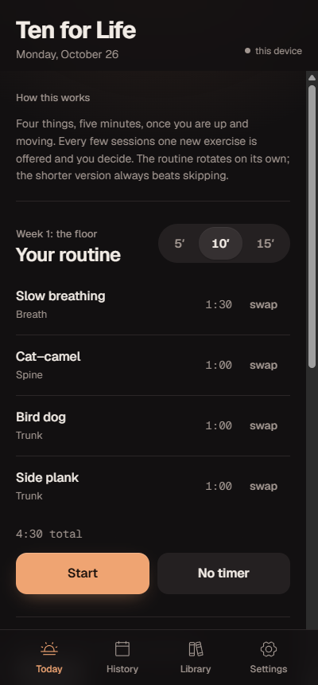
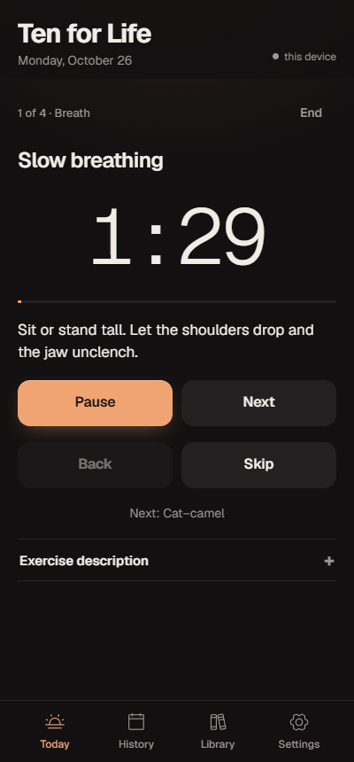

# Ten for Life

A short morning routine that grows with you. Five, ten or fifteen minutes of mobility, breath, trunk
strength, balance and qigong, built fresh every day.

**[Open the app](https://sirsirio.github.io/ten-for-life/)** and install it to your home screen. It works offline.

  
  &nbsp;
  

## How it works

- **Pick your time.** 5, 10 or 15 minutes. The app fills each slot (breath, spine, trunk, posture, hips,
  balance and more) with the exercise you have done least recently, so the routine rotates on its own.
- **It starts small.** Four exercises on day one. Every few sessions one new exercise is offered, and you
  decide whether it joins the rotation. The shorter version always beats skipping.
- **A separate posture programme.** Five or ten minutes of chin tucks, upper-back extension, chest opening
  and wall work, tracked on its own.
- **Guided or self-paced.** A countdown with a soft chime, or move on when you are ready. Every exercise
  explains why it is there, what it protects, how to do it and the common mistakes, most with a video demo.
- **Fits your day.** Tell it what equipment you have, or switch on travel mode for floor-only sessions.
- **Beyond the morning.** Weekly goals for strength, intervals, easy movement, time with friends and time
  outdoors, a calendar of your sessions, and a few simple benchmarks to retest over time.

## Evidence, graded honestly

Each exercise carries an evidence grade. **Strong** means trials or large consistent data for the stated
reason, **moderate** means real but limited support, **thin** means plausible practitioner knowledge
without trials. Sources are named in the app. Nothing here treats a condition; persistent pain belongs
with a clinician.

## Private by design

- No account, no server, no tracking. Your log stays in your browser.
- Optional sync between your devices through a private GitHub gist, **encrypted on the device** with your
  passphrase. Only scrambled text ever leaves your phone.
- Personal notes and your own version of each exercise live in a profile on your devices, never in this
  code. The code here is the general version.

## Built with

A single HTML page with plain JavaScript and no framework, assembled by a small Python script and
published to GitHub Pages on every push. Type in Geist, icons from Phosphor.
